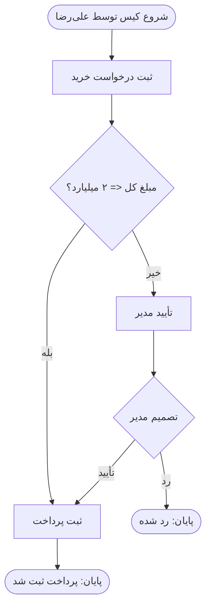

# فرایند مدیریت درخواست خرید — ProcessMaker 3.5.8

> نسخه: 1.0  
> هدف: پیاده‌سازی قابل‌کنترل فرایند درخواست خرید در ProcessMaker 3.5.8 Community  
> وضعیت این مخزن: بسته راهنمای پیاده‌سازی و آزمون؛ **فایل PMX قابل Import ادعا نمی‌شود**، چون صحت بسته نهایی باید در همان نصب ProcessMaker آزمایش شود.

## 1) تصمیم‌های طراحی

- شروع‌کننده و ثبت‌کننده درخواست: **علی‌رضا غلام** با نام کاربری `کاربر`.
- فعالیت اول با حالت **Self Service** اجرا می‌شود؛ بنابراین شخصی که کیس را شروع می‌کند فرم ثبت را تکمیل می‌کند. علی‌رضا باید با حساب خودش کیس را آغاز کند.
- مبلغ کل از حاصل‌ضرب تعداد در قیمت واحد محاسبه می‌شود؛ کاربر نباید بتواند آن را دستی تغییر دهد.
- مبلغ کل تا سقف **۲٬۰۰۰٬۰۰۰٬۰۰۰ تومان (شامل این عدد)** بدون تأیید مدیر به پرداخت می‌رود.
- مبلغ بیشتر از این سقف به مدیر ارجاع می‌شود.
- رد درخواست به پایان ردشده منتهی می‌شود و هیچ فعالیت پرداختی ایجاد نمی‌شود.
- تأیید مدیر به فعالیت ثبت پرداخت منتهی می‌شود.
- مدیر و مسئول پرداخت باید در نصب مقصد به کاربران واقعی تخصیص داده شوند؛ نام یا حسابی برای آن‌ها حدس زده نشده است.

## 2) نمودار جریان

## 3) فعالیت‌ها و تخصیص

| فعالیت | نوع تخصیص | تنظیم |
|---|---|---|
| ثبت درخواست خرید | Self Service | شروع‌کننده کیس، فرم را ثبت می‌کند |
| تأیید مدیر | Manual Assignment | پس از ساخت/انتخاب حساب مدیر، فقط به مدیر یا گروه مدیران تخصیص داده شود |
| ثبت پرداخت | Manual Assignment | پس از ساخت/انتخاب حساب مسئول مالی، فقط به مسئول پرداخت یا گروه مالی تخصیص داده شود |

**مهم:** Self Service برای فعالیت اول است، نه برای کل فرایند. برای دو فعالیت بعدی از Manual Assignment استفاده کنید. در هر فعالیت، بررسی کنید که کاربر/گروه مقصد واقعاً عضو همان workspace باشد و مجوز لازم برای کار با کیس را داشته باشد.

## 4) متغیرهای فرایند

از نام‌های انگلیسی زیر برای متغیرهای داخلی استفاده کنید؛ برچسب‌های فرم فارسی باشند.

| متغیر | نوع | کاربرد |
|---|---|---|
| `request_no` | Text | شماره درخواست |
| `requester_name` | Text | نام و نام خانوادگی درخواست‌کننده |
| `requester_mobile` | Text | تلفن همراه |
| `item_name` | Text | نام کالا |
| `item_description` | Textarea | شرح کالا |
| `quantity` | Number | تعداد |
| `unit_price` | Number | قیمت واحد به تومان |
| `total_amount` | Number | مبلغ کل به تومان؛ فقط خواندنی |
| `request_status` | Text | در انتظار بررسی / تأیید شده / رد شده / پرداخت شده |
| `manager_decision` | Text | approved یا rejected |
| `manager_notes` | Textarea | توضیحات مدیر |
| `manager_decision_date` | Date | تاریخ تصمیم |
| `payment_amount` | Number | مبلغ پرداخت |
| `payment_method` | Text | card_to_card / bank_transfer / cash / other |
| `payment_tracking_no` | Text | کد پیگیری |
| `payment_date` | Date | تاریخ پرداخت |
| `payment_notes` | Textarea | توضیحات پرداخت |

تمام متغیرها را در بخش Variables فرایند ایجاد کنید و دقیقاً با همین نام‌ها نگه دارید. از حروف فارسی یا فاصله در نام متغیر استفاده نکنید.

## 5) فرم ثبت درخواست خرید

یک Dynaform با نام «ثبت درخواست خرید» بسازید و فیلدها را به متغیرهای جدول بالا متصل کنید:

1. شماره درخواست — Text، فقط خواندنی (در نسخه اول می‌تواند توسط ثبت‌کننده تکمیل شود؛ تولید خودکار شماره را تا زمان آزمون Trigger فعال نکنید).
2. نام و نام خانوادگی — Text، اجباری.
3. شماره همراه — Text، اجباری؛ اعتبارسنجی ۱۱ رقم و شروع با 09.
4. نام کالا — Text، اجباری.
5. شرح کالا — Textarea، اختیاری.
6. تعداد — Number، اجباری، حداقل 1.
7. قیمت واحد (تومان) — Number، اجباری، حداقل 0.
8. مبلغ کل (تومان) — Number، فقط خواندنی.

فرمول محاسبه مبلغ کل:

`total_amount = quantity × unit_price`

در Dynaform، مبلغ کل را با رویداد تغییر تعداد و قیمت واحد به‌روزرسانی کنید. در سمت فرایند نیز قبل از Gateway مبلغ را دوباره اعتبارسنجی کنید؛ به مقدار ارسالی از مرورگر به‌تنهایی اعتماد نکنید.

## 6) فرم تأیید مدیر

Dynaform «تأیید مدیر» شامل خلاصه فقط‌خواندنی درخواست و این موارد باشد:

- تصمیم مدیر: تأیید / رد — اجباری.
- توضیحات مدیر — در صورت رد اجباری.
- تاریخ تصمیم — اجباری، مقدار پیش‌فرض تاریخ جاری.

Gateway بعد از فعالیت مدیر بر اساس مقدار داخلی `manager_decision` مسیر را تعیین کند:
- `approved` → ثبت پرداخت
- `rejected` → پایان ردشده

از متن نمایشی فارسی برای شرط Gateway استفاده نکنید؛ مقدار داخلی ثابت انگلیسی ذخیره شود.

## 7) فرم ثبت پرداخت

Dynaform «ثبت پرداخت» شامل خلاصه درخواست و این فیلدها باشد:

- مبلغ پرداخت — Number، اجباری و برابر مبلغ قابل پرداخت.
- روش پرداخت — فهرست: کارت‌به‌کارت، حواله بانکی، نقدی، سایر.
- شماره پیگیری — برای حواله بانکی اجباری؛ در روش‌های دیگر اختیاری.
- تاریخ پرداخت — اجباری.
- توضیحات — اختیاری.

پس از ثبت پرداخت، وضعیت درخواست به `paid` تغییر کند و کیس به پایان موفق برسد.

## 8) Gateway مبلغ

Gateway بلافاصله پس از «ثبت درخواست خرید» قرار می‌گیرد:

- مسیر مستقیم به «ثبت پرداخت»: `total_amount <= 2000000000`
- مسیر به «تأیید مدیر»: `total_amount > 2000000000`

شرط‌ها باید عددی باشند، نه مقایسه رشته‌ای. واحد تمام مبالغ در این فرایند تومان است.

## 9) وضعیت‌ها و گزارش

مقادیر پیشنهادی وضعیت:

- `submitted` — ثبت شده
- `pending_manager` — در انتظار تأیید مدیر
- `approved` — تأیید شده
- `rejected` — رد شده
- `paid` — پرداخت شده

گزارش‌های پایه:
1. درخواست‌ها به تفکیک وضعیت.
2. درخواست‌های در انتظار تأیید مدیر.
3. درخواست‌های ردشده به همراه توضیح مدیر.
4. پرداخت‌ها به تفکیک روش و بازه تاریخ.
5. مجموع مبلغ درخواست‌ها و مجموع مبالغ پرداخت‌شده.

## 10) چک‌لیست قبل از انتشار

- [ ] همه متغیرها ساخته و به فیلدهای درست متصل شده‌اند.
- [ ] Dynaform هر سه فعالیت ذخیره و به فعالیت مربوط متصل شده است.
- [ ] فعالیت اول Self Service است.
- [ ] فعالیت مدیر به حساب/گروه واقعی مدیر Manual Assignment شده است.
- [ ] فعالیت پرداخت به حساب/گروه واقعی مالی Manual Assignment شده است.
- [ ] دو شرط Gateway با مرز ۲٬۰۰۰٬۰۰۰٬۰۰۰ تومان تنظیم شده‌اند.
- [ ] مسیر رد مدیر مستقیماً به پایان ردشده می‌رود.
- [ ] مسیر تأیید مدیر به ثبت پرداخت می‌رود.
- [ ] دسترسی شروع کیس برای علی‌رضا و دسترسی کار روی فعالیت‌ها کنترل شده است.
- [ ] حداقل سناریوهای آزمون بخش بعد اجرا شده‌اند.

## 11) سناریوهای آزمون پذیرش

| آزمون | ورودی/عمل | نتیجه مورد انتظار |
|---|---|---|
| A | مبلغ ۲٬۰۰۰٬۰۰۰٬۰۰۰ | بدون فعالیت مدیر، ورود به ثبت پرداخت |
| B | مبلغ ۲٬۰۰۰٬۰۰۰٬۰۰۱ | ارجاع به مدیر |
| C | مدیر رد می‌کند | پایان ردشده؛ فعالیت پرداخت ایجاد نشود |
| D | مدیر تأیید می‌کند | ورود به ثبت پرداخت |
| E | روش حواله بانکی بدون کد پیگیری | فرم اجازه ثبت ندهد |
| F | تعداد صفر یا منفی | فرم اجازه ثبت ندهد |
| G | تغییر تعداد یا قیمت واحد | مبلغ کل دوباره محاسبه شود |
| H | کاربر غیرمجاز | نتواند فعالیت مدیر/پرداخت را انجام دهد |

**معیار تحویل نهایی:** همه آزمون‌ها در یک محیط ProcessMaker 3.5.8 واقعی با حساب‌های مجزا اجرا شوند. صرف معتبر بودن XML یا موفقیت Import به معنی سالم بودن گردش کار نیست.
